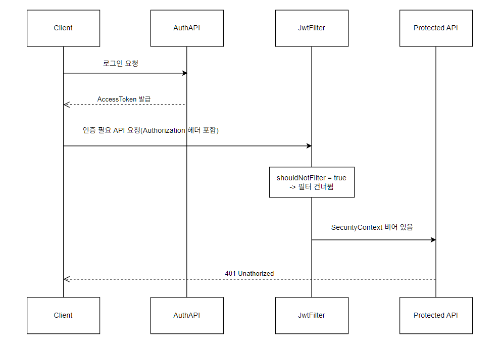
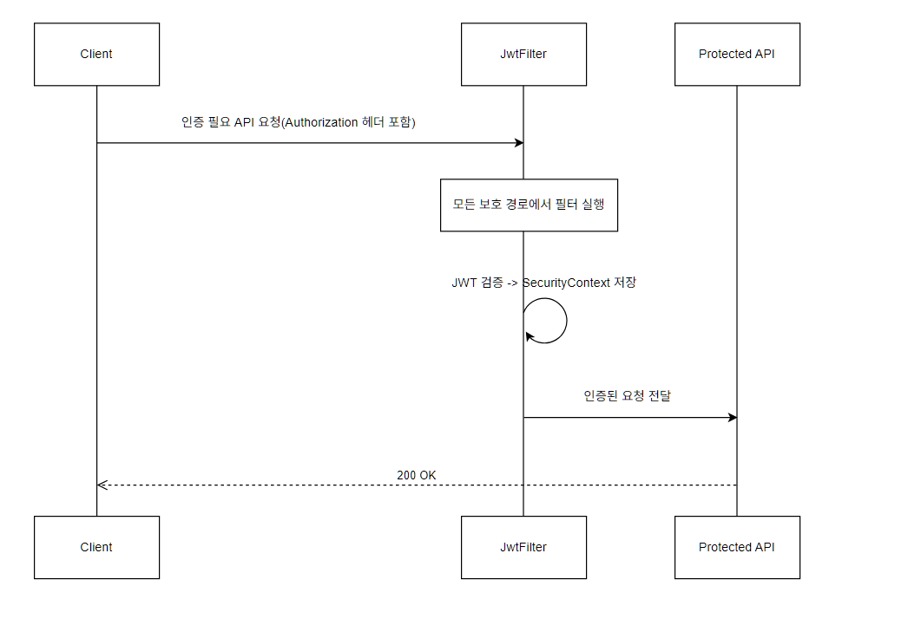

# 3. 로그인 직후 인증이 풀리는 현상

## 문제 상황

로그인 API는 정상 응답하고 AccessToken도 발급되었지만, 로그인 직후 인증이 필요한<br>
기능을 이용 시 `401 Unauthorized`가 발생했습니다.

프론트엔드에서는 401응답을 받으면 인증 상태가 초기화되어, 사용자 입장에서는 로그인 직후<br>
화면이 처음 상태로 돌아가는 것처럼 보였습니다.

## 원인
토큰을 정상 발급되었는데도 인증이 실패했기 때문에, 토큰 발급이 아니라 `요청 시점의 인증 처리`를 의심했습니다.

원인은 `인증 제외 경로를 두 곳에서 따로 관리`하고 있던 것이었습니다.

1.`SecurityConfig` 경로의 설정
2. `JwtAuthenticationFilter.shouldNotFilter()`경로의 설정

```java
// SecurityConfig
.authorizeHttpRequests(authorize -> authorize
    .requestMatchers("/chatrooms/**").authenticated())
.addFilterBefore(jwtAuthenticationFilter, UsernamePasswordAuthenticationFilter.class);
```

```java
// JwtAuthenticationFilter
@Override
protected boolean shouldNotFilter(HttpServletRequest request) {
    String path = request.getRequestURI().substring(request.getContextPath().length());

    if (path.startsWith("/admin/auth/") || path.equals("/admin/auth")) {
        return true;
    }
    if (path.equals("/auth/signup") || path.equals("/auth/login") || path.equals("/auth/reissue")) {
        return true;
    }
    return false;
}
```

두 설정의 기준이 어긋나면, `인증이 필요한 경로인데 JWT필터가 실행되지 않는 요청`이 생깁니다. <br>
이 경우 요청에 유효한 토큰이 담겨 있어도 필터가 토큰을 검증하지 않아 <br>
`SecurityContextHolder`가 비어있고, 이후 `authenticated()` 검사에서 인증 실패 처리되어 401이 반환됩니다.



## 해결 과정

1. **제외 경로 기준**을 `SecurityConfig`**한 곳으로 단일화**했습니다. <br>
`permitAll()`로만 관리하고, 필터의 `shouldNotFilter`에서 따로 판단하던 경로를 정리했습니다.
2. JWT필터는 **모든 보호 리소스 요청에서 일관되게 실행**되도록 수정했습니다.
3. 필터에서 `Authorization`헤더를 로깅해 **토큰 자체가 누락된 요청**과 **토큰은 있는 필터가** <br>
**건너뛴 요청**을 구분했고, 토큰 누락 케이스를 하나씩 제거 했습니다. 



## 결과

- 로그인 직후에도 인증이 필요한 기능을 정상적으로 사용할 수 있게 되었습니다.
- 페이지 이동, 새로고침 시 로그아웃된 것처럼 보이던 현상을 해소되었습니다.