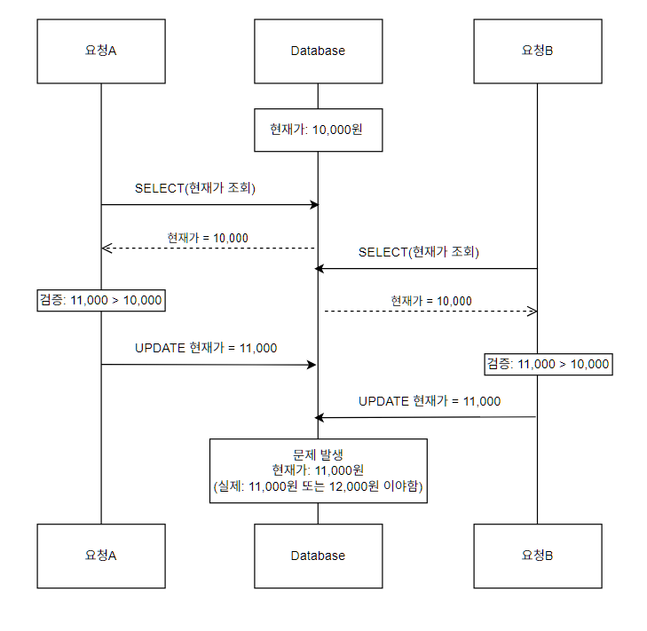
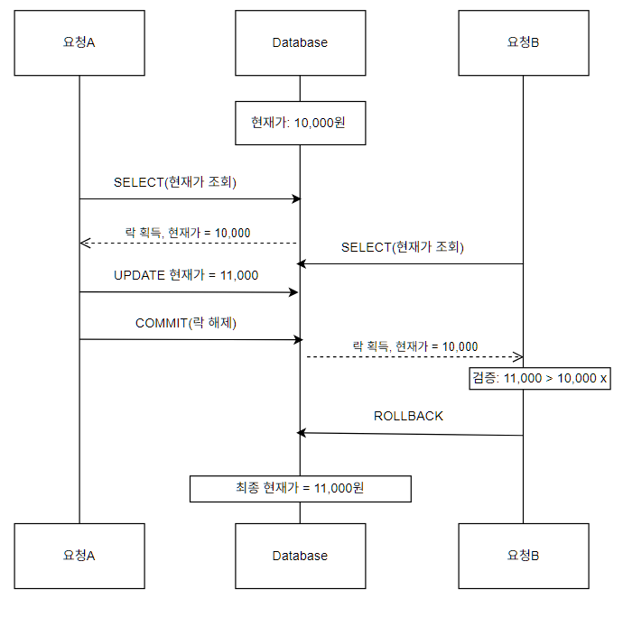

# 2. 입찰 동시성 제어

## 문제 상황
여러 사용자가 **같은 경매 상품에 동시에 입찰**하면, 현재가 갱신은 유실되거나 입찰 기록과 최고가가 어긋날 수 있습니다.

입찰 로직은 ``현재가 조회 -> 입찰가 검증 -> 입찰 기록 저장 -> 현재가 갱신``순서로 동작하는데, 이 네 단계가 하나의 원자적 연산이 아니기 때문입니다.



## 원인

일반 `SELECT`는 락을 걸지 않는 조회입니다. A와 B가 같은 시점의 현재가를 읽고 <br> 각자 검증을 
통과한 뒤 저장하므로, **검증 시점의 값과 저장 시점의 값이 달라지는 Lost Update**가 발생합니다.

## 해결 과정 

|        | 낙관적 락(Optimistic)              | 비관적 락(Pessimistic)    |
|:-------|:-------------------------------|-----------------------|
| 방식     | 충돌을 가정하지 않고, 저장 시점에 버전으로 충돌 감지 | 조회 시점에 행을 잠그는 순서대로 처리 | 
| 충돌시    | 예외 발생 -> 재시도 필요                | 대기 후 순서대로 처리          |
| 유리한 경우 | 충돌이 드문 경우                      | 충돌이 잦은 경우             | 

경매는 **마감 직전에 입찰 경쟁이 몰릴 것으로 예상**되는 도메인이라, 같은 상품에 대한 충돌 
가능성이 높다고 판단했습니다. <br> 낙관적 락을 쓰면 충돌 때마다 재시도가 필요하고, 재시도 요청끼리
다시 충돌할 수 있습니다. <br> 그래서 **처리 순서를 보장하는 비관적 락**을 선택했습니다.

### 적용

입찰 전용 조회 메서드에만 `PESSIMISTIC_WRITE`락을 적용했습니다.

```java
@Lock(LockModeType.PESSIMISTIC_WRITE)
@Query("SELECT a FROM AuctionProductsEntity a WHERE a.auctionId = :auctionId")
Optional<AuctionProductsEntity> findByIdWithLock(Long auctionId);
```
- 입찰 서비스 메서드를 하나의 트랜잭션으로 묶어 ``조회(락 획득) -> 검증 -> 저장 -> 갱신 -> 커밋(락 해제)``이 직렬로 수행되게 했습니다.
- **일반 조회 API는 기존 쿼리를 그대로 사용**해, 락이 조회 성능이 영향을 주지 않도록 입찰 전용 쿼리를 분리했습니다.



## 결과
- 동시 입찰 요청이 **같은 상품에 대해서는 순서대로 처리**되어, 나중 요청은 갱신된 현재가를 기준으로 검증됩니다.
- 락은 입찰 시에만 걸리므로 일반 조회 쿼리에는 영향을 주지 않습니다.