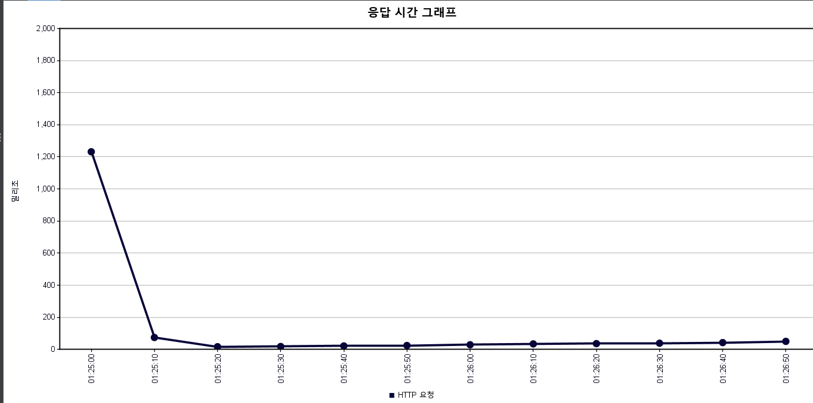
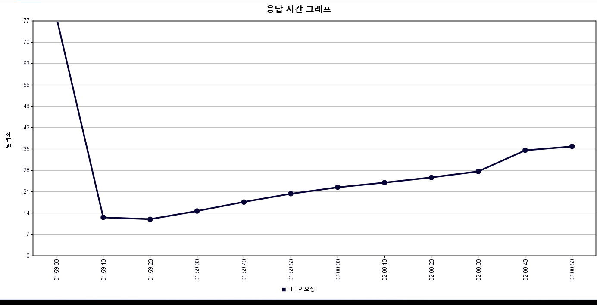

# 1. 상품 목록 조회 성능 최적화

## 문제 상황

전체 상품 목록 조회 API에 **JMeter로 7,000건 부하**를 주었을 때,
**평균 응답 시간은 42ms**로 <br>양호했지만 **일부 요청에서 최대 1,240ms**까지 급격히 느려지는 현상이 발생했습니다.

평균만 보면 문제가 없어 보이지만, 평균 대비 최댓값이 약 30배 차이 나면 일부 사용자는 목록<br> 화면에서 눈에 띄는 지연을 겪게 됩니다.
그래서 평균이 아닌 **최대 응답 시간을 함께 기준 지표**로 삼았습니다.



## 원인

목록 API 한 번 호출 시 DB에서 실행되는 쿼리를 따라가며 병목 후보를 찾았습니다.

### 1. 메인 Native Query
상품 상태, 카테고리, 가격 조건으로 필터링하고 정렬과 페이징 후 <br>
상품마다 **대표 이미지 URL과 찜 개수를 서브쿼리**로 조회합니다.

### 2. 찜 여부 확인
로그인 사용자가 각 상품을 찜했는지를 DTO 매핑 루프 안에서 <br>
**상품 한 건씩 개별 조회**했습니다.한 페이지에 상품이 N개면 추가 쿼리가 N번 <br>
실행되는 **N+1문제**가 발생했습니다.

```java
// 개선 전: 매핑 루프 안에서 상품마다 찜 여부를 DB로 조회
List<AuctionListResponseDto> dtoList = projectionPage.getContent().stream()
        .map(p -> {
            boolean liked = false;
            if (userId != null) {
                liked = wishlistRepository.existsByUser_UserIdAndAuction_AuctionId(userId, p.getAuctionId());
            }
            return AuctionListResponseDto.builder()
                    .auctionId(p.getAuctionId())
                    .title(p.getTitle())
                    .currentPrice(p.getCurrentPrice())
                    .createdAt(p.getCreatedAt())
                    .endTime(p.getEndTime())
                    .sellingStatus(calculateSellingStatusFromDbValue(p.getSellingStatus(), p.getEndTime(), p.getStartTime()))
                    .sellerId(p.getSellerId())
                    .sellerNickname(p.getSellerNickname())
                    .mainImageUrl(p.getMainImageUrl())
                    .wishCount(p.getWishCount())
                    .liked(liked)
                    .build();
        })
        .collect(Collectors.toList());
```
| 분석 구간               | 주요 원인 (Issue)                  | 성능 영향 (Impact)                |
|:--------------------|:-------------------------------|:------------------------------|
| **이미지 및 찜 개수 서브쿼리** | `auction_id` 인덱스 부재            | 데이터가 늘수록 비례해 느려짐              |
| **목록 필터 및 정렬**      | 상태,  카테고리, 가격 조건에 맞는 복합 인덱스 부재 | 조건 검색과 정렬 비용 증가               |
| **찜 여부 확인**         | 상품마다 개별 쿼리 실행 (**N+1 문제**)     | 로그인 사용자 요청 시 페이지 크기만큼 쿼리 수 증가 |


## 해결 과정

### 1) 쿼리에 맞춘 인덱스 설계
쿼리의 조건 및 정렬 컬럼을 기준으로 인덱스 4개를 추가했습니다.

```sql
-- 1. 상태 필터 + 가격 조건 + 최신순 정렬
CREATE INDEX idx_auction_status_price_date
ON Auction_Products (selling_status, current_price, created_at DESC);

-- 2. 카테고리 필터 + 상태 필터 + 마감 임박순 정렬
CREATE INDEX idx_auction_category_status_endtime
ON Auction_Products (category_id, selling_status, end_time ASC);

-- 3. 대표 이미지 서브쿼리 (auction_id + image_type 조건)
CREATE INDEX idx_image_auction_type
ON image (auction_id, image_type);

-- 4. 찜 개수 서브쿼리 (COUNT)
CREATE INDEX idx_wish_auction
ON wish_list (auction_id);
```

### 2) 찜 여부 N+1 제거
위 개선 전 코드를 바꿔 상품마다 찜 여부를 조회하는 대신 **현재 페이지 상품 id를 모아 ``IN``절로 한번에 조회하도록 바꿨습니다.

```java
// WishlistRepository: 현재 페이지 상품 중 사용자가 찜한 ID만 일괄 조회
@Query("SELECT w.auction.auctionId FROM WishlistEntity w " +
       "WHERE w.user.userId = :userId AND w.auction.auctionId IN :auctionIds")
List<Long> findLikedAuctionIdsByUserIdAndAuctionIds(
        @Param("userId") Long userId,
        @Param("auctionIds") List<Long> auctionIds
);
```

```java
// AuctionService: 조회 결과 → ID 추출 → 1회 조회 → Set으로 메모리 매칭
List<Long> auctionIds = projectionPage.getContent().stream()
        .map(AuctionListProjection::getAuctionId)
        .collect(Collectors.toList());

Set<Long> likedAuctionIds = new HashSet<>();
if (userId != null && !auctionIds.isEmpty()) {
    likedAuctionIds.addAll(
        wishlistRepository.findLikedAuctionIdsByUserIdAndAuctionIds(userId, auctionIds));
}

// DTO 매핑 시 DB 호출 없이 Set에서 확인
boolean liked = likedAuctionIds.contains(p.getAuctionId());
```

### 3) 동일 조건 재측정
개선 전/후 모두 동일한 부하 조건(7,000건) 으로 JMeter를 실행해 비교했습니다.

## 결과 
| 지표       | 개선 전    | 개선 후 | 변화 |
|:---------|:--------|:-----|----|
| 평균 응답 시간 | 42ms    | 25ms | 약 40% 단축|
| 최대 응답 시간 | 1,240ms | 36ms | 약 97% 감소|

